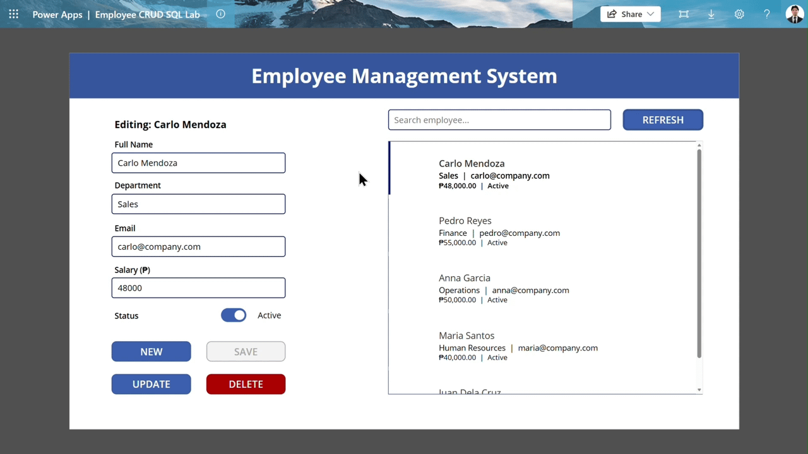
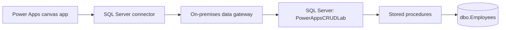
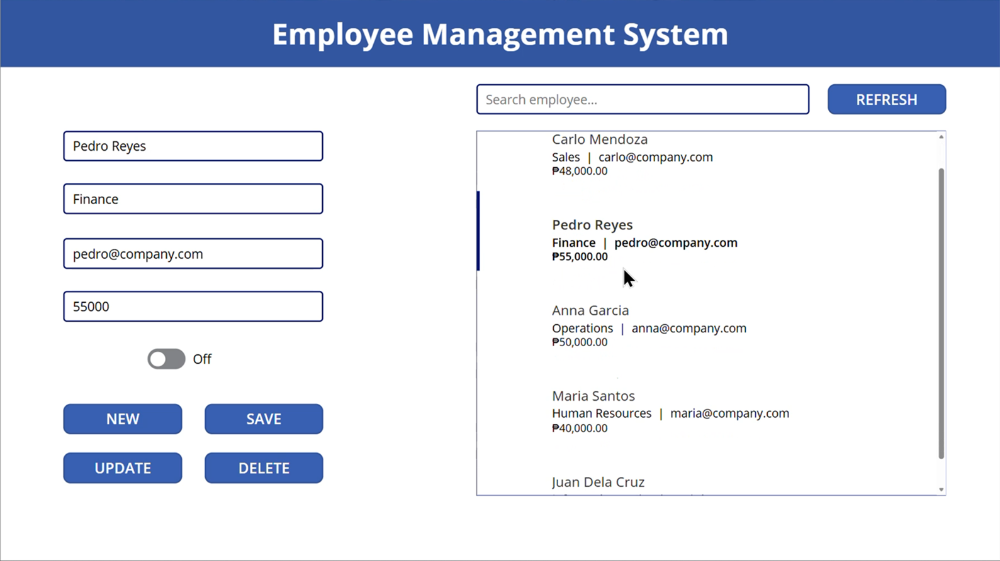
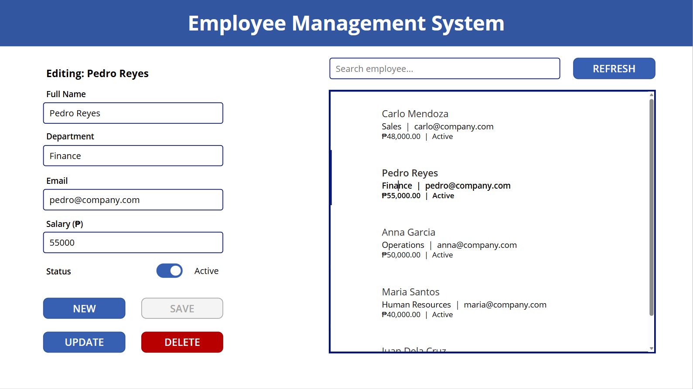

# Employee Management System (Power Apps, SQL Server)

A CRUD canvas app in Power Apps that lets an HR user add, view, edit, search, and delete employee records. Every create, read, update, and delete runs through a SQL Server stored procedure. The app reaches the local SQL Server database through an on-premises data gateway.



<!-- Second commit: add the LinkedIn post link and the Google Drive walkthrough link here -->

## Table of Contents

1. [Overview](#overview)
2. [Architecture](#architecture)
3. [Features](#features)
4. [Improvements Beyond the Lab](#improvements-beyond-the-lab)
5. [Before and After](#before-and-after)
6. [Key Code](#key-code)
7. [Testing](#testing)
8. [Challenges and Fixes](#challenges-and-fixes)
9. [Tools and Skills](#tools-and-skills)
10. [Files](#files)
11. [Data Source](#data-source)
12. [Limitations and Next Steps](#limitations-and-next-steps)
13. [Version History](#version-history)

## Overview

**Problem:** An HR team needs one place to keep employee records: name, department, email, salary, and active status. The records should live in a real database, not in a spreadsheet, and the app should only change data through controlled database logic.

**Approach:** The app was built as the Power Apps capstone lab requirement for an AI Automation Bootcamp I attended. I followed the lab guide given by our instructor for the database, the stored procedures, and the base app. Some parts of the lab that did not work as written were restructured through searching for other techniques to improve the app's usability, data safety, and accessibility (see [Improvements Beyond the Lab](#improvements-beyond-the-lab)). This is a guided project and my first app built with Power Apps, made as I began exploring Power Platform development.

**Related project:** [Employee Record Automation with Data Validation (Excel VBA)](https://github.com/david-861/Employee-Record-Automation-with-Data-Validation-Excel-VBA) solves a similar employee-records problem inside Excel. This project takes the same idea further, with a real database, stored procedures, and a cloud app.

## Architecture



- **Frontend:** Power Apps canvas app "Employee CRUD SQL Lab" (one screen, classic controls), inside a Power Platform solution in a developer environment.
- **Backend:** SQL Server database `PowerAppsCRUDLab` on a local instance, with one table (`dbo.Employees`) and five stored procedures.
- **Connection:** an on-premises data gateway carries each request from Power Apps in the cloud to SQL Server on the laptop. The app connects with a dedicated SQL login that is mapped only to the lab database.

**Table: `dbo.Employees`**

| Column | Data type | Notes |
|-|-|-|
| EmployeeID | INT IDENTITY(1,1) | Primary key |
| FullName | NVARCHAR(100) | Required |
| Department | NVARCHAR(100) | Required |
| Email | NVARCHAR(150) | Optional |
| Salary | DECIMAL(18,2) | Optional |
| IsActive | BIT | Default 1 (active) |
| CreatedDate | DATETIME | Default GETDATE() |

**Stored procedures**

| Procedure | What it does | Used by the app |
|-|-|-|
| `usp_Employee_Read` | Returns all employees | Yes (app start, after every change, REFRESH) |
| `usp_Employee_Create` | Inserts a record and returns it using `SCOPE_IDENTITY()` | Yes (SAVE) |
| `usp_Employee_Update` | Updates a record by `EmployeeID` and returns it | Yes (UPDATE) |
| `usp_Employee_Delete` | Deletes a record by `EmployeeID` | Yes (YES, DELETE) |
| `usp_Employee_Search` | Searches name, department, and email with `LIKE` | Not yet (tested in SSMS only) |

## Features

- **Create:** NEW clears the form and switches it to new-record mode. SAVE checks that Full Name and Department are filled in before it calls the Create procedure.
- **Read:** the gallery lists every employee with department, email, salary in pesos, and Active or Inactive status. Clicking an employee loads the record into the form.
- **Update:** UPDATE saves the edited record through the Update procedure.
- **Delete with confirmation:** DELETE opens a confirmation box that names the selected employee ("Delete Pedro Reyes? This cannot be undone."). Only YES, DELETE removes the record.
- **Search:** one search box matches text anywhere in the name, department, or email, without regard to capitalization. When nothing matches, the gallery shows "No employees match your search."
- **Refresh:** REFRESH reloads the list from SQL Server.
- **Clear form states:** the form header reads "Add New Employee:", "Editing: [name]", or "No employee selected".
- **Button states:** SAVE works only for a new record. UPDATE and DELETE work only when an employee is selected.
- **Feedback:** every action shows a notification, such as "Employee successfully created."

## Improvements Beyond the Lab

| Area | Lab as written | What changed |
|-|-|-|
| Loading data | `ClearCollect(colEmployees, ...ResultSets.Table1)` kept failing | Typed each field with `ForAll` and `Value`, `Text`, and `Boolean`, because stored procedure results come back untyped |
| New record | `varNewRecord` was set but never read, so NEW did not clear the form | Wired `varNewRecord` into every input's Default |
| Data safety | UPDATE and DELETE could run on the wrong employee after NEW | Added a guard (`varNewRecord \|\| IsBlank(galEmployees.Selected.EmployeeID)`) and button states that follow the same rule |
| Search | `StartsWith` on the name only | Contains search with the `in` operator across name, department, and email |
| Form reset | The toggle kept its old value when two employees had the same status | Reset every input when an employee is selected |
| Reload after SAVE | Email was missing from the reload, so emails disappeared after saving | Added Email to every reload |
| Interface | Inputs with no labels and an On/Off toggle | Caption labels, form header states, Active/Inactive toggle text, peso salary format, status in the gallery, red DELETE button, empty-search message |
| Accessibility and performance | 16 accessibility errors and 1 performance warning in App checker | Accessible labels, tab stops, and focus borders; `AllItemsCount` for the empty-search check. App checker now shows no errors |

## Before and After

| Before (October 11, 2026) | After (November 2026) |
|-|-|
|  |  |

## Key Code

**Loading typed records from the Read procedure (Power Fx, `scrEmployees.OnVisible`)**

```powerfx
Set(varShowDeleteConfirmation, false);
Set(varNewRecord, false);
ClearCollect(
    colEmployees,
    ForAll(
        PowerAppsCRUDLab.dbouspEmployeeRead().ResultSets.Table1,
        {
            EmployeeID: Value(ThisRecord.EmployeeID),
            FullName: Text(ThisRecord.FullName),
            Department: Text(ThisRecord.Department),
            Email: Text(ThisRecord.Email),
            Salary: Value(ThisRecord.Salary),
            IsActive: Boolean(ThisRecord.IsActive)
        }
    )
)
```

**Guarding UPDATE and DELETE (Power Fx)**

```powerfx
// btnUpdate.DisplayMode and btnDelete.DisplayMode
If(varNewRecord || IsBlank(galEmployees.Selected.EmployeeID), DisplayMode.Disabled, DisplayMode.Edit)

// btnDelete.OnSelect
If(
    varNewRecord || IsBlank(galEmployees.Selected.EmployeeID),
    Notify("Please select an employee to delete.", NotificationType.Warning),
    Set(varShowDeleteConfirmation, true)
)
```

**Update procedure (T-SQL)**

```sql
CREATE PROCEDURE dbo.usp_Employee_Update
    @EmployeeID INT,
    @FullName NVARCHAR(100),
    @Department NVARCHAR(100),
    @Email NVARCHAR(150),
    @Salary DECIMAL(18,2),
    @IsActive BIT
AS
BEGIN
    SET NOCOUNT ON;

    UPDATE dbo.Employees
    SET FullName = @FullName,
        Department = @Department,
        Email = @Email,
        Salary = @Salary,
        IsActive = @IsActive
    WHERE EmployeeID = @EmployeeID;

    SELECT EmployeeID, FullName, Department, Email, Salary, IsActive, CreatedDate
    FROM dbo.Employees
    WHERE EmployeeID = @EmployeeID;
END;
```

Formatted for readability. The full SSMS scripts are in the [`sql`](sql/) folder.

## Testing

Every change was checked in both the app and SQL Server (`SELECT * FROM dbo.Employees;` in SSMS).

| # | Test | Expected result | Result |
|-|-|-|-|
| 1 | Open the app | All employees appear in the gallery | Pass |
| 2 | Create a test employee (James Clear) | The record appears in the gallery and in SQL Server | Pass |
| 3 | Update the test employee's department, salary, and status | SQL Server shows the new values | Pass |
| 4 | Search by part of a name, a department, and lowercase text | Matching employees appear | Pass |
| 5 | Search for text with no match (typed "zzz" in the search bar) | "No employees match your search." | Pass |
| 6 | Click NEW, then try UPDATE or DELETE | Both buttons are disabled | Pass |
| 7 | Click DELETE, then NO | The box closes and the record stays | Pass |
| 8 | Click DELETE, then YES, DELETE | The record disappears from the app and from SQL Server | Pass |
| 9 | Change the toggle without saving, then select another employee | The toggle shows the employee's real status | Pass |
| 10 | Run App checker | No errors | Pass |

## Challenges and Fixes

| Problem | Cause | Fix |
|-|-|-|
| The lab's Read formula kept failing | Stored procedure results come back untyped in Power Apps | Typed each field inside `ForAll` |
| "The request was not sent or there is no response from the server" | Opened the app in Power Apps without opening or running SQL Server first | Started SQL Server, then reopened the app |
| SQL errors 15023 and 15025 while creating the app's login | A deleted login left an orphaned database user behind | Found the orphan with a verification query, dropped it, and mapped a new login |
| Emails disappeared after SAVE | The reload after SAVE did not include Email | Added Email to the reload |
| The status toggle kept the old value | An input returns to its Default only when the Default value changes | Reset the inputs whenever an employee is selected |

## Tools and Skills

- **Power Apps:** canvas app, Power Fx, classic controls, App checker, publishing
- **SQL Server and SSMS:** T-SQL, table design, stored procedures, `SCOPE_IDENTITY()`, SQL logins and database users
- **On-premises data gateway:** connecting a cloud app to a local database
- **Power Platform:** solutions, developer environment (Power Apps Developer Plan)
- **Git and GitHub:** version control
- **Industrial Engineering:** error-proofing (poka-yoke) with button states and guards, and a repeatable test checklist

## Files

- `assets/ems_demo.gif`: short demo of the app
- `assets/before_oct_2026.png` and `assets/after_nov_2026.png`: the app before and after the improvements
- `sql/`: SQL scripts for the Employees table and the five stored procedures (from SSMS)

## Data Source

All employee records are fictional sample data from the lab's setup script, plus test records added during testing. The repository contains no real personal data.

## Limitations and Next Steps

- **Development use only:** the app runs in a Power Apps Developer Plan environment, which is meant for development and testing.
- **Local backend:** the laptop, SQL Server, and the gateway must be running for the app to work.
- **Search runs in the app:** the app loads every employee and filters the list itself. This is fine for a small table. Next step: call `usp_Employee_Search` so SQL Server does the searching.
- **Repeated reload code:** the same reload formula sits in several buttons. Next step: keep it in one place.
- **Free-text department:** next step: a department dropdown, after cleaning the existing department values.
- **Interface:** next step: merge SAVE and UPDATE into one button and move NEW above the list.

## Version History

- **v2 (November 2026):** fixed the form reset, added button states, form header states, captions, status display, and the empty-search message; cleared all App checker errors; republished.
- **v1 (October 2026):** app build with CRUD through stored procedures, search, refresh, and delete confirmation; published from the developer environment.
